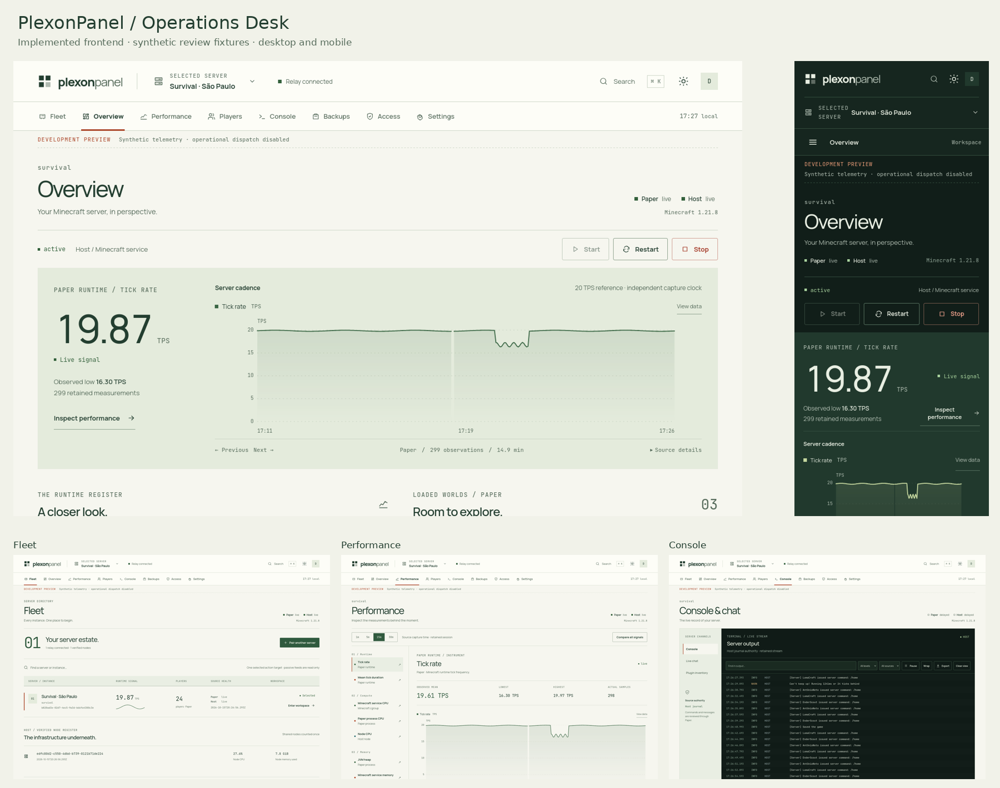

# PlexonPanel · Operations Desk

A new Minecraft operations control plane built with React 19, TypeScript and Vite. It reconstructs every workspace while preserving PlexonPanel Protocol 3, authenticated relay sessions, immutable device grants and reviewed server operations.



Preview data is synthetic and isolated to development fixtures.

## Run locally

Node 24.x:

```sh
npm ci
cp .env.example .env.local
npm run dev
```

Set only the public `VITE_PLEXON_RELAY_URL`. Private signing keys, Cloudflare credentials and service secrets do not belong in frontend variables.

## Validate

```sh
npm run check
npm run build
npm run test:perf
npx playwright install firefox
node scripts/qa-local.mjs
node scripts/qa-local.mjs scripts/control-plane-check.mjs
node scripts/qa-local.mjs scripts/visual-proofs.mjs
node --import tsx scripts/telemetry-profile.mjs
```

`npm run test:browser` also works with a separately running local server in the same network namespace. The browser harnesses permit localhost only, disable third-party skins and use clearly labelled development fixtures. Production excludes the fixture module.

## Review and rollout

Start with [verification](docs/NEW_DASHBOARD_VERIFICATION.md), [feature parity](docs/FEATURE_PARITY_MATRIX.md), [compatibility](docs/NEW_DASHBOARD_COMPATIBILITY.md), [design](docs/NEW_DASHBOARD_DESIGN.md), [risks](docs/NEW_DASHBOARD_RISKS.md), and [rollout/rollback](docs/NEW_DASHBOARD_ROLLOUT.md).

Frontend production deployment and GitHub release publication were authorized by the owner on 2026-10-15. See [the release notes](docs/releases/dashboard-operations-desk-2026.10.15.md). Actual paired Paper/Host/VPS acceptance remains separate. Backend changes, relay allowlist changes and service/JAR replacement require separate authorization.
