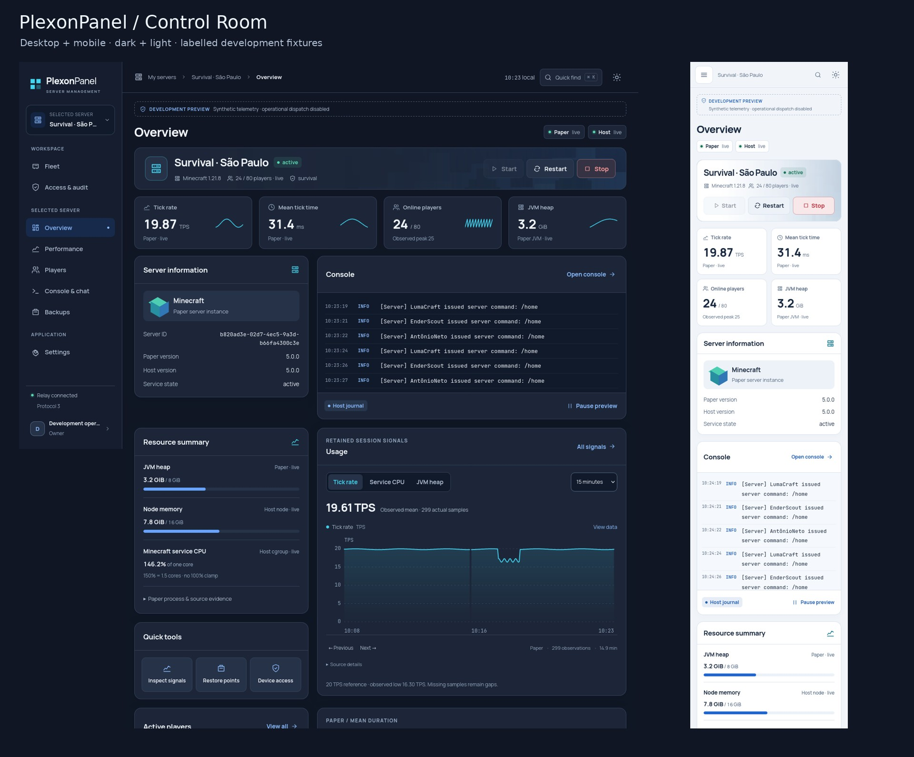

# PlexonPanel · Control Room

A reference-led Minecraft server management interface built with React 19, TypeScript and Vite. A persistent sidebar, console-led Overview, source-aware instrumentation and substantial player profiles replace Operations Desk's presentation while preserving Protocol 3, stored pairing, immutable grants and reviewed server operations.



Screens depict labelled development fixtures. Production data still comes exclusively from authenticated Paper/Host sessions.

## Run

Node 24.x:

```sh
npm ci
cp .env.example .env.local
npm run dev
```

Set only the public `VITE_PLEXON_RELAY_URL`. Never put signing keys, access tokens or service secrets into frontend variables. Development-only visual review: `http://127.0.0.1:4173/?fixture=healthy#Overview`.

## Verify

```sh
npm run check
npm run build
npm run test:perf
npx playwright install firefox
node scripts/qa-local.mjs
node scripts/qa-local.mjs scripts/control-plane-check.mjs
node scripts/qa-local.mjs scripts/reconstruction-check.mjs
node scripts/qa-local.mjs scripts/reference-check.mjs
node scripts/qa-local.mjs scripts/review-confirmation-check.mjs
node scripts/qa-local.mjs scripts/visual-proofs.mjs
node scripts/qa-local.mjs scripts/extended-visual-proofs.mjs
MOZ_DISABLE_CONTENT_SANDBOX=1 node scripts/production-check.mjs
```

The production artifact excludes fixture data and always requires pairing for an unpaired browser. Browser scripts are localhost-only; the UI cannot issue live operations through development fixtures.

## Review and release

Read [verification](docs/NEW_DASHBOARD_VERIFICATION.md), [parity](docs/FEATURE_PARITY_MATRIX.md), [compatibility](docs/NEW_DASHBOARD_COMPATIBILITY.md), [design](docs/NEW_DASHBOARD_DESIGN.md), [risks](docs/NEW_DASHBOARD_RISKS.md), and [rollout/rollback](docs/NEW_DASHBOARD_ROLLOUT.md).

This branch is a review candidate. Production cutover requires release-specific authorization and real paired-server acceptance. No backend deployment or server-state migration is included.
