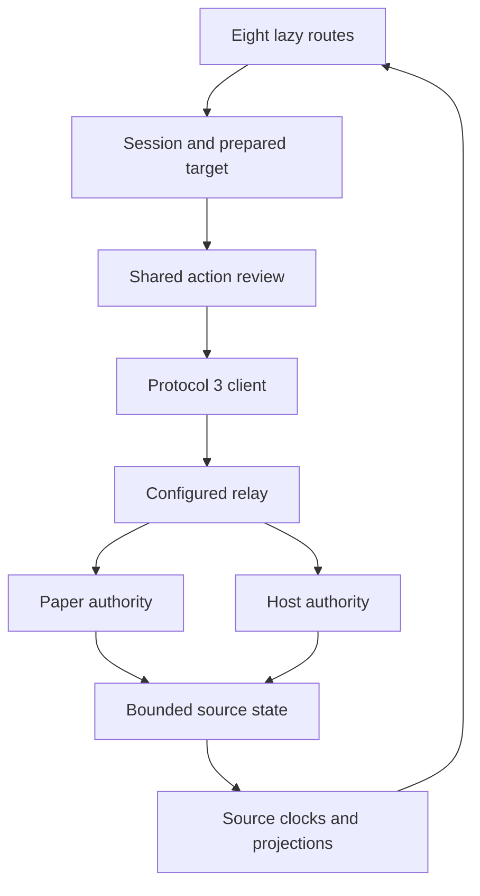

# Source audit and planning evidence

Version 1.0 · audit date 2026-10-16 · no production connection or product implementation.

## 1. Identity and provenance

| Item | Independently verified identity | Interpretation |
| --- | --- | --- |
| Frontend | `ZpkDxGames/PlexonPanel-Dashboard` commit `4357a66bc674fddce7432cbc27a4fead00ac8234`; tree `17f44ce9ca5d282b5b9236dd35be451066a9cad2`; committed `2026-10-16T13:46:35Z` | Merge PR #90, Control Room; not the older Operations Desk |
| Backend | `ZpkDxGames/PlexonPanel` commit `209f8b41d4fe6360a8dcf2f9cdabe7b7df6cc128`; tree `4754ccb1a80c69eacde903a1883b40454cab7c32`; committed `2026-10-12T23:55:11Z` | Paper/Host telemetry cadence and console-policy synchronization |
| Branch refs | Both `main` refs equaled these SHAs when inspected | A time-bound planning observation; Sol must check again before branching |
| Working copies | Detached pinned checkouts; no tracked changes after audit/build/screenshots | Dependency/build/artifact files are untracked or ignored, excluded from the source archives |
| Supplied brief | Original `INSTRUCTIONS.md` copied unchanged to `source/brief/` | Authoritative starting requirements, reconciled with current source and explicit owner boundaries |
| Source ZIP provenance | ZIPs generated by `git archive` from verified commit objects | Complete tracked source trees, not reconstructed snippets; SHA-256 and object checks included |

The attachments supplied the brief and commit-pinned archive URL/checkout helpers, rather than an already materialized full source ZIP. This planning run independently obtained complete Git checkouts, verified both commits and inspected the files. The supplied `SOURCE_SNAPSHOT.md` described a previous inspection environment without a build or archive download; it does not describe this run. Its unmodified copy is historical provenance under `source/brief/`. No claim is made that the owner is running either pinned commit in production.

## 2. Architecture actually present

The frontend is a static React/TypeScript/Vite application with eight lazy hash routes, a session external store, origin-bound IndexedDB pairing, a bounded control-state reducer, presentation projections and project SVG charts. `session.prepare` freezes target parameters; `ActionReview` collects review; `session.execute` revalidates target and current authority. UI role labels cannot grant rights. `session.reason` is the fail-closed mutation gate.

The browser talks to a configured relay. Paper supplies game/player/chat/plugin/command authority; Host supplies service/node resources, retained journal and manual backup orchestration. The inspected repositories contain the browser client and agents/protocol contracts. A complete deployed relay implementation and its runtime configuration were **not independently audited** here; historical documentation points to relay locations that are not a current relay tree in these checkouts.

Arrows express logical data/control ownership; agent packets still travel through the relay. The relay node is a contract relationship, not a deployment verification. Mutations complete from an authoritative agent result, not a queued transport receipt. A manual-backup create agent result can itself mean only a queued durable Host job.

## 3. Current facts versus historical material

| Material | Classification | How to use it |
| --- | --- | --- |
| Pinned TSX, adapters, Java handlers, package/lock and tests | CURRENT SOURCE | Primary evidence of implemented behavior; source presence does not prove runtime correctness |
| Fresh 32 captures and results JSON in this package | RENDERED FIXTURE | Evidence of current local Control Room composition and automated checks; synthetic values only |
| `docs/NEW_DASHBOARD_*`, `REFERENCE_UI_REVAMP_BRIEF.md`, `control-room-preview.jpg` | CURRENT-ERA REPORT / earlier recorded measurements | Useful intent and previous test reports; candidate wording can predate merge; not independent reruns |
| `docs/DESIGN_SYSTEM.md`, `PLAN.md`, `UI_REFINEMENT.md`, Operations Desk release/proof files | HISTORICAL / mixed lineage | Identify prior proposals; do not restore old sidebar/card layouts or absent preferences from them |
| Backend 4.0/staged-schema language alongside 5.0.0 prepared source | HISTORICAL where contradicted by actual handlers/config | Do not infer activation or a deployed release from a document heading |
| `dist/build.json` actual commit/build time/protocol | CURRENT LOCAL BUILD | Confirms which frontend source built locally; not VPS or agent version |
| `build.json` hard-coded referenceDashboard/referenceCore | HISTORICAL REFERENCE | Not current remote HEAD, backend deployment identity or proof of compatibility |
| Owner fleet names/topology in the brief | OWNER CONTEXT | Useful realistic design context; never inject these as production telemetry |
| Planning PNGs in `design/` | PROPOSED DESIGN | Static composition wireframes, not working UI, browser screenshots or measured values |

## 4. Route and preference inventory

The full feature-by-feature map is `FEATURE_PARITY_AND_RISK_MATRIX.md`. Its action table records canonical action, scope, agent kind, target and review requirements. This concise index identifies the actual main surfaces.

| Route | Current work surface and retained features | Redesign gap grounded in evidence |
| --- | --- | --- |
| Fleet | Paired directory, selected/passive feeds, search, source observations, verified shared-node aggregation, Settings pairing link | Give selection and node evidence distinct ledgers; do not create fleet-wide mutations |
| Overview | Identity/versions, lifecycle, TPS/MSPT/players/heap, source scopes, usage ranges, console preview, worlds, player preview, tick observations | Rendered facts precede principal instrument; chart/console should lead |
| Performance | Eight signals, focus/compare, 1/5/15/30m, observed mean/min/max, exact samples, pin/keyboard, gaps, source clocks, GC | Improve catalog and inspection composition; comparison performance remains a measurement risk |
| Players | Search/world/sort, in-page exact-UUID profile, private message/game mode/whitelist/heal/feed/moderation/op, command/LuckPerms builders, paginated history, heads | Refine profile/tool hierarchy; failed head state persists across provider changes in source |
| Console | Console/Chat/Plugins, source/severity/search, bounded window/wrap, pause/tail, local clear/undo/export, reviewed Paper commands/chat/reload | Fixed 480px viewport/28px rows need responsive measurement; follow status needs explicit inspecting state |
| Backups | Host preflight/status/list, manual countdown/create, job/progress/phases, local/remote proof, archive verify/delete, retry | Rendered recovery evidence too far below inventory on mobile; richer preflight fields are underused |
| Access | Agent-specific self/full audit, devices with Host mirror, Paper revoke, current-browser protection, scope list | Replace badge-only authority presentation with action-level read-only reasons |
| Settings | Four chapters: appearance/connection/privacy/diagnostics; relay save/reconnect/pair, build details, safe copy | Current saved feedback can overstate persistence; all preference effects need broad QA |

All eight preferences and exact defaults are locked: theme `dark`; density `comfortable`; textSize `standard`; accent `teal`; motion `full`; chartFill `true`; timezone `browser`; skinProvider `crafatar`. Allowed enums and legacy `reduceMotion` migration are listed in the design specification and matrix. Pairing credentials are not a ninth localStorage preference. Display-rate and restart-schedule controls from earlier designs are absent and must not be resurrected.

## 5. Operational distinctions verified in source

- Freshness is computed from source capture with browser receipt support; a capture more than 5 seconds in the future relative to receipt gets skew handling and receipt-based age. It is not an absolute clock-drift test. The 10/30-second bands remain; delayed/skew can still be usable. Unrelated traffic does not refresh a source.
- Cgroup service CPU is percent of one core and can exceed 100%; JVM process CPU and node CPU are different producers. JVM heap, service memory and node physical memory are not interchangeable. Missing or stale capacity cannot justify a meter.
- Prepared actions capture server/revision/agent generation, action and cloned parameters. Start/stop have extra fresh Host service-state checks. Do not silently broaden those checks to restart or claim every lifecycle action has identical prerequisites.
- Typed confirmation applies to ban, kill, op, deop and full-backup delete; confirmed metadata also covers HIGH_RISK, console execution and configured plugin reload. Queries do not automatically inherit reviewed mutation semantics.
- Device list can use a Host mirror, but revoke targets Paper. Player history requests bind exact UUID/server and opaque cursor with limit 25; audit limit is 50. No new endpoint, unbounded history or inferred global authority is part of Strata.
- Host preflight can return safe source size/count, storage capacity and provider status. A provider/source failure may stop subsequent checks; absent later fields remain unknown. Current route coarse gates are not proof those absent fields passed.
- Host backup create returns accepted job ID with state QUEUED. Host subsequently owns warning, final save, stop proof, local archive/verification, remote transfer/verification, cleanup and recovery. Availability, upload percentage, agent action success and durable job completion are separate facts.
- Restores/recovery resolution may exist in backend code but have no complete existing browser flow in this baseline. They stay deferred; adding a new live operation requires a separately specified and authorized project.

### Bounded-data inventory

| Data | Source bound | Constraint |
| --- | --- | --- |
| Raw metric history | 35 minutes and 8, 192 points | Both bounds preserved; range selector does not create older data |
| Console live | 2, 500 lines | No-wrap virtualized; wrap renders latest 400 |
| Persisted console | Latest 500 from bounded authorized records | Do not describe reload as full retained Host history |
| Chat | 200 live; 100 in safe cache | No invented historical fetch |
| Player roster | 512 | Paged snapshot input is bounded |
| Worlds / plugin inventory | 64 / 256 | No unbounded table ingestion |
| Presence deltas / presence history | 512 / 1, 024 | Different bounded collections, not a lifetime journal |
| Fleet sockets | 16 total including selected | Passive sessions remain read-only and separate |
| Sample table | Latest 50 | Do not confuse displayed table with whole retained history |

## 6. Confirmed observations and unresolved hypotheses

Design gaps D01–D12 in the design specification distinguish SOURCE, RENDERED, DOCUMENTED and HYPOTHESIS. Rendered observations were made on current local Overview desktop/light, Backups mobile/dark, Console mobile/light and a contact sheet of all routes. Automated screenshots cover every route/theme/size; detailed manual review was not performed on every pixel of every state. The existing checks reported no axe/overflow/page errors. This does not establish WCAG conformance, keyboard quality, physical-device behavior, large-text/zoom reflow, all state transitions or sustained performance.

Confirmed source risks: head-provider failure reset (D07), optional storage versus saved wording (D09), hard-coded terminal geometry (D05) and uneven preflight detail (D04). Proposed fixes require meaningful regression evidence; a code reading alone is not a reproduced user incident. Higher eight-track replay p95 is a repository report, not newly profiled here. No performance failure has been manufactured to justify a redesign.

## 7. Independent planning verification

| Command / activity | Result in this run | Evidence and limit |
| --- | --- | --- |
| Git identity + tracked diff | Both exact commits; clean tracked product files | `evidence/source-identity.json`; archives verified against tracked blobs |
| `npm ci --ignore-scripts` | Dependencies installed for local analysis | No dependency versions changed; package lock retained |
| `npm run check` | PASS: TypeScript and 61 tests, 0 failures | Tool execution observed; summarized in verification record; raw stdout not retained |
| `npm run build` | PASS | Original build.json copied; package source identity matches |
| `npm run test:perf` | PASS: 89, 808 initial JS gzip bytes; existing budget 184, 320; 15 JS assets | Original machine-readable report included; Vite rounded compression output is not this canonical metric |
| `node scripts/qa-local.mjs scripts/visual-proofs.mjs` | PASS: 32 cases, zero reported axe/overflow failures; page/console error assertions passed | Original 32 full-page screenshots and result JSON; local healthy fixture, skins disabled, nonlocal requests blocked |
| Backend build/tests | NOT_EXECUTED | Relevant current Java/contract source inspected only |
| Other browser/control/reconstruction/reference suites, replay/long soak | NOT_EXECUTED independently in planning | Historical repo reports only; required later by QA plan |
| Live agents, VPS, backup providers, production | NOT_EXECUTED | Outside planning authorization |

Runtime: Node 24.19.0; pinned Playwright 1.64.0 Firefox (downloaded browser build 1555 / Firefox 157). Screenshot pages are development builds, while gzip evidence comes from the production build. See `evidence/verification-record.json` for commands and classifications. Do not compare these local measurements to a production deployment as if they were equivalent.

## 8. Source anchors

Every link below is commit-pinned. Paths and symbols are provided for offline review against the enclosed archives. A span identifies the relevant entry; for whole-route parity consult the complete file. The machine-readable index is `evidence/source-anchors.json`.

| Ref | Source / lines | Verified responsibility |
| --- | --- | --- |
| E01 | [PlexonPanel-Dashboard/package.json:1–31](https://github.com/ZpkDxGames/PlexonPanel-Dashboard/blob/4357a66bc674fddce7432cbc27a4fead00ac8234/package.json#L1-L31) | Exact runtime/dependencies and executable scripts; no lint command. |
| E02 | [PlexonPanel-Dashboard/src/App.tsx:14–80](https://github.com/ZpkDxGames/PlexonPanel-Dashboard/blob/4357a66bc674fddce7432cbc27a4fead00ac8234/src/App.tsx#L14-L80) | Eight lazy routes, entry gate and server/revision/Paper/Host keyed view identity. |
| E03 | [PlexonPanel-Dashboard/src/router.ts:1–23](https://github.com/ZpkDxGames/PlexonPanel-Dashboard/blob/4357a66bc674fddce7432cbc27a4fead00ac8234/src/router.ts#L1-L23) | Case-sensitive hash route IDs and fallback navigation. |
| E04 | [PlexonPanel-Dashboard/src/entry-state.ts:1–12](https://github.com/ZpkDxGames/PlexonPanel-Dashboard/blob/4357a66bc674fddce7432cbc27a4fead00ac8234/src/entry-state.ts#L1-L12) | Splash, pairing and dashboard transition gate. |
| E05 | [PlexonPanel-Dashboard/src/components/Shell.tsx:1–230](https://github.com/ZpkDxGames/PlexonPanel-Dashboard/blob/4357a66bc674fddce7432cbc27a4fead00ac8234/src/components/Shell.tsx#L1-L230) | Current Control Room sidebar/header, target switcher, mobile dialog and command palette. |
| E06 | [PlexonPanel-Dashboard/src/components/PairingForm.tsx:1–45](https://github.com/ZpkDxGames/PlexonPanel-Dashboard/blob/4357a66bc674fddce7432cbc27a4fead00ac8234/src/components/PairingForm.tsx#L1-L45) | Real name/code/origin form, validation, claim lifecycle; masked input. |
| E07 | [PlexonPanel-Dashboard/src/components/PairingGate.tsx:1–61](https://github.com/ZpkDxGames/PlexonPanel-Dashboard/blob/4357a66bc674fddce7432cbc27a4fead00ac8234/src/components/PairingGate.tsx#L1-L61) | Unpaired entry composition and form placement. |
| E08 | [PlexonPanel-Dashboard/src/adapter/browser-store.ts:14–158](https://github.com/ZpkDxGames/PlexonPanel-Dashboard/blob/4357a66bc674fddce7432cbc27a4fead00ac8234/src/adapter/browser-store.ts#L14-L158) | IndexedDB v3 workspace; credentials, server labels and cached control state. |
| E09 | [PlexonPanel-Dashboard/src/adapter/relay-config.ts:1–57](https://github.com/ZpkDxGames/PlexonPanel-Dashboard/blob/4357a66bc674fddce7432cbc27a4fead00ac8234/src/adapter/relay-config.ts#L1-L57) | Origin normalization/configuration and allowed relay credential selection. |
| E10 | [PlexonPanel-Dashboard/src/adapter/device-grant.ts:1–53](https://github.com/ZpkDxGames/PlexonPanel-Dashboard/blob/4357a66bc674fddce7432cbc27a4fead00ac8234/src/adapter/device-grant.ts#L1-L53) | Signed/reported authority reconciliation; no role-based bypass. |
| E11 | [PlexonPanel-Dashboard/src/adapter/session.ts:408–522](https://github.com/ZpkDxGames/PlexonPanel-Dashboard/blob/4357a66bc674fddce7432cbc27a4fead00ac8234/src/adapter/session.ts#L408-L522) | Fail-closed mutation gate, prepared target snapshot, validity checks and dispatch. |
| E12 | [PlexonPanel-Dashboard/src/adapter/session.ts:521–555](https://github.com/ZpkDxGames/PlexonPanel-Dashboard/blob/4357a66bc674fddce7432cbc27a4fead00ac8234/src/adapter/session.ts#L521-L555) | Query path and current target binding; no UI-invented action protocol. |
| E13 | [PlexonPanel-Dashboard/src/adapter/data-source.ts:384–495](https://github.com/ZpkDxGames/PlexonPanel-Dashboard/blob/4357a66bc674fddce7432cbc27a4fead00ac8234/src/adapter/data-source.ts#L384-L495) | Queued/control results, rejection boundary and pending action resolution. |
| E14 | [PlexonPanel-Dashboard/src/adapter/data-source.ts:507–586](https://github.com/ZpkDxGames/PlexonPanel-Dashboard/blob/4357a66bc674fddce7432cbc27a4fead00ac8234/src/adapter/data-source.ts#L507-L586) | Bound action target and response wait; transport acknowledgement is not completion. |
| E15 | [PlexonPanel-Dashboard/src/adapter/scopes.ts:1–164](https://github.com/ZpkDxGames/PlexonPanel-Dashboard/blob/4357a66bc674fddce7432cbc27a4fead00ac8234/src/adapter/scopes.ts#L1-L164) | Canonical actions/scopes and HIGH_RISK set; generated comment is not an existing npm script. |
| E16 | [PlexonPanel-Dashboard/src/features/ActionReview.tsx:1–160](https://github.com/ZpkDxGames/PlexonPanel-Dashboard/blob/4357a66bc674fddce7432cbc27a4fead00ac8234/src/features/ActionReview.tsx#L1-L160) | One shared reviewed execution surface; target/parameters/typed confirmation and result. |
| E17 | [PlexonPanel-Dashboard/src/presentation/review-policy.ts:1–18](https://github.com/ZpkDxGames/PlexonPanel-Dashboard/blob/4357a66bc674fddce7432cbc27a4fead00ac8234/src/presentation/review-policy.ts#L1-L18) | Typed action set and additional confirmed flags for console/plugin reload. |
| E18 | [PlexonPanel-Dashboard/src/features/capabilities.ts:1–19](https://github.com/ZpkDxGames/PlexonPanel-Dashboard/blob/4357a66bc674fddce7432cbc27a4fead00ac8234/src/features/capabilities.ts#L1-L19) | Read helpers and capability presentation; mutation must use session.reason. |
| E19 | [PlexonPanel-Dashboard/src/adapter/control-state.ts:112–157](https://github.com/ZpkDxGames/PlexonPanel-Dashboard/blob/4357a66bc674fddce7432cbc27a4fead00ac8234/src/adapter/control-state.ts#L112-L157) | History/console bounds and bounded input-record parsing. |
| E20 | [PlexonPanel-Dashboard/src/adapter/control-state.ts:324–388](https://github.com/ZpkDxGames/PlexonPanel-Dashboard/blob/4357a66bc674fddce7432cbc27a4fead00ac8234/src/adapter/control-state.ts#L324-L388) | Presence, plugin, console and chat reducer bounds. |
| E21 | [PlexonPanel-Dashboard/src/adapter/control-state.ts:475–492](https://github.com/ZpkDxGames/PlexonPanel-Dashboard/blob/4357a66bc674fddce7432cbc27a4fead00ac8234/src/adapter/control-state.ts#L475-L492) | Persisted cache has smaller console/chat limits than live retention. |
| E22 | [PlexonPanel-Dashboard/src/adapter/telemetry-freshness.ts:1–90](https://github.com/ZpkDxGames/PlexonPanel-Dashboard/blob/4357a66bc674fddce7432cbc27a4fead00ac8234/src/adapter/telemetry-freshness.ts#L1-L90) | Capture/receipt freshness, 10s/30s ages and future-capture skew behavior. |
| E23 | [PlexonPanel-Dashboard/src/presentation/telemetry.ts:11–85](https://github.com/ZpkDxGames/PlexonPanel-Dashboard/blob/4357a66bc674fddce7432cbc27a4fead00ac8234/src/presentation/telemetry.ts#L11-L85) | Eight metric keys, four source assignments and independent source evidence. |
| E24 | [PlexonPanel-Dashboard/src/presentation/telemetry.ts:93–202](https://github.com/ZpkDxGames/PlexonPanel-Dashboard/blob/4357a66bc674fddce7432cbc27a4fead00ac8234/src/presentation/telemetry.ts#L93-L202) | Display-only gap/extrema reduction; finite observed statistics, GC deltas and verified nodes. |
| E25 | [PlexonPanel-Dashboard/src/presentation/epochs.ts:1–54](https://github.com/ZpkDxGames/PlexonPanel-Dashboard/blob/4357a66bc674fddce7432cbc27a4fead00ac8234/src/presentation/epochs.ts#L1-L54) | Independent source epoch ownership and clearing on identity changes. |
| E26 | [PlexonPanel-Dashboard/src/adapter/history.ts:1–21](https://github.com/ZpkDxGames/PlexonPanel-Dashboard/blob/4357a66bc674fddce7432cbc27a4fead00ac8234/src/adapter/history.ts#L1-L21) | Projection of raw samples onto their own source capture clocks. |
| E27 | [PlexonPanel-Dashboard/src/components/charts/TimeSeries.tsx:41–300](https://github.com/ZpkDxGames/PlexonPanel-Dashboard/blob/4357a66bc674fddce7432cbc27a4fead00ac8234/src/components/charts/TimeSeries.tsx#L41-L300) | Project SVG plotting, crosshair/pin/keyboard behavior, sample evidence/table and accessible summary. |
| E28 | [PlexonPanel-Dashboard/src/components/charts/geometry.ts:1–39](https://github.com/ZpkDxGames/PlexonPanel-Dashboard/blob/4357a66bc674fddce7432cbc27a4fead00ac8234/src/components/charts/geometry.ts#L1-L39) | Plot geometry consumes finite segments and preserves gap boundaries. |
| E29 | [PlexonPanel-Dashboard/src/adapter/fleet-feed.ts:1–180](https://github.com/ZpkDxGames/PlexonPanel-Dashboard/blob/4357a66bc674fddce7432cbc27a4fead00ac8234/src/adapter/fleet-feed.ts#L1-L180) | Passive fleet sessions and total connection budget; distinct from selected authority. |
| E30 | [PlexonPanel-Dashboard/src/routes/Fleet.tsx:11–240](https://github.com/ZpkDxGames/PlexonPanel-Dashboard/blob/4357a66bc674fddce7432cbc27a4fead00ac8234/src/routes/Fleet.tsx#L11-L240) | R01 current paired server directory, scoped observations and verified node grouping. |
| E31 | [PlexonPanel-Dashboard/src/routes/Overview.tsx:55–314](https://github.com/ZpkDxGames/PlexonPanel-Dashboard/blob/4357a66bc674fddce7432cbc27a4fead00ac8234/src/routes/Overview.tsx#L55-L314) | R02 readings, lifecycle prepare, observations and current technical-facts-first composition. |
| E32 | [PlexonPanel-Dashboard/src/components/ConsolePreview.tsx:1–129](https://github.com/ZpkDxGames/PlexonPanel-Dashboard/blob/4357a66bc674fddce7432cbc27a4fead00ac8234/src/components/ConsolePreview.tsx#L1-L129) | Overview read-only console source choice and bounded latest-line preview. |
| E33 | [PlexonPanel-Dashboard/src/routes/Performance.tsx:71–330](https://github.com/ZpkDxGames/PlexonPanel-Dashboard/blob/4357a66bc674fddce7432cbc27a4fead00ac8234/src/routes/Performance.tsx#L71-L330) | R03 eight signals, ranges, focused/compare modes and observed summaries. |
| E34 | [PlexonPanel-Dashboard/src/routes/Players.tsx:39–298](https://github.com/ZpkDxGames/PlexonPanel-Dashboard/blob/4357a66bc674fddce7432cbc27a4fead00ac8234/src/routes/Players.tsx#L39-L298) | R04 filters, exact UUID selection, retained hidden roster and profile. |
| E35 | [PlexonPanel-Dashboard/src/components/PlayerHistory.tsx:1–155](https://github.com/ZpkDxGames/PlexonPanel-Dashboard/blob/4357a66bc674fddce7432cbc27a4fead00ac8234/src/components/PlayerHistory.tsx#L1-L155) | Exact-UUID query, ticket isolation, bounded pagination and supported empty/error states. |
| E36 | [PlexonPanel-Dashboard/src/presentation/player-history.ts:1–23](https://github.com/ZpkDxGames/PlexonPanel-Dashboard/blob/4357a66bc674fddce7432cbc27a4fead00ac8234/src/presentation/player-history.ts#L1-L23) | History-page parser and cursor bounds; no manufactured lifetime history. |
| E37 | [PlexonPanel-Dashboard/src/lib/playerCommands.ts:1–19](https://github.com/ZpkDxGames/PlexonPanel-Dashboard/blob/4357a66bc674fddce7432cbc27a4fead00ac8234/src/lib/playerCommands.ts#L1-L19) | Command and LuckPerms builders, allowed substitutions and input guards. |
| E38 | [PlexonPanel-Dashboard/src/components/PlayerHead.tsx:1–22](https://github.com/ZpkDxGames/PlexonPanel-Dashboard/blob/4357a66bc674fddce7432cbc27a4fead00ac8234/src/components/PlayerHead.tsx#L1-L22) | Provider URL selection, fixed identity fallback and current persistent failed state. |
| E39 | [PlexonPanel-Dashboard/src/routes/Console.tsx:13–110](https://github.com/ZpkDxGames/PlexonPanel-Dashboard/blob/4357a66bc674fddce7432cbc27a4fead00ac8234/src/routes/Console.tsx#L13-L110) | Current fixed 28px row/480px viewport, follow ref and bounded wrap/no-wrap rendering. |
| E40 | [PlexonPanel-Dashboard/src/routes/Console.tsx:112–441](https://github.com/ZpkDxGames/PlexonPanel-Dashboard/blob/4357a66bc674fddce7432cbc27a4fead00ac8234/src/routes/Console.tsx#L112-L441) | R05 three tabs; filters/export/clear; Paper command review; chat and plugin inventory. |
| E41 | [PlexonPanel-Dashboard/src/lib/textFormat/index.ts:1–80](https://github.com/ZpkDxGames/PlexonPanel-Dashboard/blob/4357a66bc674fddce7432cbc27a4fead00ac8234/src/lib/textFormat/index.ts#L1-L80) | Bounded safe text-format parsing; presentation must remain inert text segments. |
| E42 | [PlexonPanel-Dashboard/src/routes/Backups.tsx:46–315](https://github.com/ZpkDxGames/PlexonPanel-Dashboard/blob/4357a66bc674fddce7432cbc27a4fead00ac8234/src/routes/Backups.tsx#L46-L315) | R06 Host reads, preflight age, current five coarse gates and manual countdown options. |
| E43 | [PlexonPanel-Dashboard/src/routes/Backups.tsx:544–588](https://github.com/ZpkDxGames/PlexonPanel-Dashboard/blob/4357a66bc674fddce7432cbc27a4fead00ac8234/src/routes/Backups.tsx#L544-L588) | Retry entry requires explicit retryable job evidence; later review also enforces scope/target. |
| E44 | [PlexonPanel-Dashboard/src/adapter/backup-readiness.ts:1–102](https://github.com/ZpkDxGames/PlexonPanel-Dashboard/blob/4357a66bc674fddce7432cbc27a4fead00ac8234/src/adapter/backup-readiness.ts#L1-L102) | Richer readiness classification helper exists separately from coarse route presentation. |
| E45 | [PlexonPanel-Dashboard/src/adapter/maintenance.ts:1–19](https://github.com/ZpkDxGames/PlexonPanel-Dashboard/blob/4357a66bc674fddce7432cbc27a4fead00ac8234/src/adapter/maintenance.ts#L1-L19) | Durable maintenance phase/progress parsing; do not infer completed phases. |
| E46 | [PlexonPanel-Dashboard/src/routes/Access.tsx:9–288](https://github.com/ZpkDxGames/PlexonPanel-Dashboard/blob/4357a66bc674fddce7432cbc27a4fead00ac8234/src/routes/Access.tsx#L9-L288) | R07 audit self/full/source, device listing/revoke and effective scope view. |
| E47 | [PlexonPanel-Dashboard/src/routes/Settings.tsx:17–81](https://github.com/ZpkDxGames/PlexonPanel-Dashboard/blob/4357a66bc674fddce7432cbc27a4fead00ac8234/src/routes/Settings.tsx#L17-L81) | Four deep-link sections and current preference-saved feedback. |
| E48 | [PlexonPanel-Dashboard/src/routes/Settings.tsx:188–457](https://github.com/ZpkDxGames/PlexonPanel-Dashboard/blob/4357a66bc674fddce7432cbc27a4fead00ac8234/src/routes/Settings.tsx#L188-L457) | R08 all appearance choices, relay/reconnect, pairing, privacy provider and diagnostics. |
| E49 | [PlexonPanel-Dashboard/src/store/preferences.ts:1–78](https://github.com/ZpkDxGames/PlexonPanel-Dashboard/blob/4357a66bc674fddce7432cbc27a4fead00ac8234/src/store/preferences.ts#L1-L78) | All eight enums/defaults, legacy migration, optional storage and document application. |
| E50 | [PlexonPanel-Dashboard/src/styles.css:1–90](https://github.com/ZpkDxGames/PlexonPanel-Dashboard/blob/4357a66bc674fddce7432cbc27a4fead00ac8234/src/styles.css#L1-L90) | Current monolithic stylesheet; use complete archived file for responsive/override audit, not this opening span alone. |
| E51 | [PlexonPanel-Dashboard/src/development/fixtures.ts:1–95](https://github.com/ZpkDxGames/PlexonPanel-Dashboard/blob/4357a66bc674fddce7432cbc27a4fead00ac8234/src/development/fixtures.ts#L1-L95) | DEV fixture entry/data; fixture labels are not production observations. |
| E52 | [PlexonPanel-Dashboard/scripts/visual-proofs.mjs:1–83](https://github.com/ZpkDxGames/PlexonPanel-Dashboard/blob/4357a66bc674fddce7432cbc27a4fead00ac8234/scripts/visual-proofs.mjs#L1-L83) | 32-route capture workflow, blocked external requests, axe/overflow and page-error assertions. |
| E53 | [PlexonPanel-Dashboard/scripts/performance.mjs:1–11](https://github.com/ZpkDxGames/PlexonPanel-Dashboard/blob/4357a66bc674fddce7432cbc27a4fead00ac8234/scripts/performance.mjs#L1-L11) | Canonical gzip budget calculation; actual result included in evidence/performance.json. |
| E54 | [PlexonPanel-Dashboard/scripts/identity.mjs:1–20](https://github.com/ZpkDxGames/PlexonPanel-Dashboard/blob/4357a66bc674fddce7432cbc27a4fead00ac8234/scripts/identity.mjs#L1-L20) | Actual commit and build time; referenceDashboard/referenceCore are hard-coded historical references. |
| E55 | [PlexonPanel/protocol/src/main/java/io/github/zpkdxgames/plexonpanel/security/RequestGate.java:1–41](https://github.com/ZpkDxGames/PlexonPanel/blob/209f8b41d4fe6360a8dcf2f9cdabe7b7df6cc128/protocol/src/main/java/io/github/zpkdxgames/plexonpanel/security/RequestGate.java#L1-L41) | Server-side request authorization, not a substitute for protocol validation upstream. |
| E56 | [PlexonPanel/protocol/src/main/java/io/github/zpkdxgames/plexonpanel/security/Scopes.java:67–161](https://github.com/ZpkDxGames/PlexonPanel/blob/209f8b41d4fe6360a8dcf2f9cdabe7b7df6cc128/protocol/src/main/java/io/github/zpkdxgames/plexonpanel/security/Scopes.java#L67-L161) | Backend canonical scopes and action mappings; cross-check frontend generated manifest. |
| E57 | [PlexonPanel/protocol/src/main/java/io/github/zpkdxgames/plexonpanel/control/ControlEngine.java:97–214](https://github.com/ZpkDxGames/PlexonPanel/blob/209f8b41d4fe6360a8dcf2f9cdabe7b7df6cc128/protocol/src/main/java/io/github/zpkdxgames/plexonpanel/control/ControlEngine.java#L97-L214) | Bounded execution, local authorization and HIGH_RISK confirmation; lifecycle lane does not queue. |
| E58 | [PlexonPanel/host-agent/src/main/java/io/github/zpkdxgames/plexonpanel/host/HostMain.java:251–354](https://github.com/ZpkDxGames/PlexonPanel/blob/209f8b41d4fe6360a8dcf2f9cdabe7b7df6cc128/host-agent/src/main/java/io/github/zpkdxgames/plexonpanel/host/HostMain.java#L251-L354) | Safe preflight fields, maintenance create accepted as QUEUED, verify/delete/retry handlers. |
| E59 | [PlexonPanel/host-agent/src/main/java/io/github/zpkdxgames/plexonpanel/host/FullBackupPreflight.java:1–150](https://github.com/ZpkDxGames/PlexonPanel/blob/209f8b41d4fe6360a8dcf2f9cdabe7b7df6cc128/host-agent/src/main/java/io/github/zpkdxgames/plexonpanel/host/FullBackupPreflight.java#L1-L150) | Provider/source/staging/capacity checks and safe failure.stage; earlier failure leaves later evidence absent. |
| E60 | [PlexonPanel/host-agent/src/main/java/io/github/zpkdxgames/plexonpanel/host/MaintenanceManager.java:1–190](https://github.com/ZpkDxGames/PlexonPanel/blob/209f8b41d4fe6360a8dcf2f9cdabe7b7df6cc128/host-agent/src/main/java/io/github/zpkdxgames/plexonpanel/host/MaintenanceManager.java#L1-L190) | Host-owned durable maintenance orchestration and readiness/recovery boundaries. |
| E61 | [PlexonPanel/host-agent/src/main/java/io/github/zpkdxgames/plexonpanel/host/MaintenanceStateStore.java:299–378](https://github.com/ZpkDxGames/PlexonPanel/blob/209f8b41d4fe6360a8dcf2f9cdabe7b7df6cc128/host-agent/src/main/java/io/github/zpkdxgames/plexonpanel/host/MaintenanceStateStore.java#L299-L378) | Restart reconciliation preserves explicit recovery gate when destructive maintenance may have begun. |
| E62 | [PlexonPanel/host-agent/src/main/java/io/github/zpkdxgames/plexonpanel/host/FullRestorePointManager.java:398–497](https://github.com/ZpkDxGames/PlexonPanel/blob/209f8b41d4fe6360a8dcf2f9cdabe7b7df6cc128/host-agent/src/main/java/io/github/zpkdxgames/plexonpanel/host/FullRestorePointManager.java#L398-L497) | Local archive verification and restore-point behavior; backend support is not a browser workflow. |
| E63 | [PlexonPanel/docs/PROTOCOL.md:1–87](https://github.com/ZpkDxGames/PlexonPanel/blob/209f8b41d4fe6360a8dcf2f9cdabe7b7df6cc128/docs/PROTOCOL.md#L1-L87) | Protocol 3 envelope/association design; cross-check current client and agents. |
| E64 | [PlexonPanel/docs/BACKUPS.md:1–100](https://github.com/ZpkDxGames/PlexonPanel/blob/209f8b41d4fe6360a8dcf2f9cdabe7b7df6cc128/docs/BACKUPS.md#L1-L100) | Backup operating contract, reconciled against current Host handlers. |
| E65 | [PlexonPanel/docs/INSTANCE_AUTHORIZATION.md:1–23](https://github.com/ZpkDxGames/PlexonPanel/blob/209f8b41d4fe6360a8dcf2f9cdabe7b7df6cc128/docs/INSTANCE_AUTHORIZATION.md#L1-L23) | Instance/device trust model, reconciled against actual scopes/request gates. |

## 9. Next-agent reconciliation

Sol must fetch/read current branch refs through the authorized Git integration, inspect local dirty state and compare any newer frontend/backend contract changes with this baseline before editing. The ZIP proves a planning tree, not latest status. Keep changed authority, action names, schemas or capabilities visible in a delta table. Compatible drift may be reconciled without restarting the project; incompatible operational changes need a concrete decision, never a silent frontend workaround.

No source implementation, commit, push, PR, merge, deployment, credential action or live operation was performed by this planning package. The next task is local frontend implementation and a review-ready PR. Merge and production require separate owner authorization.
